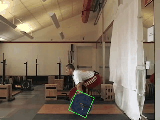
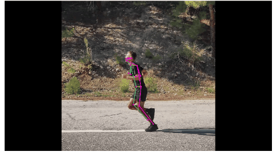
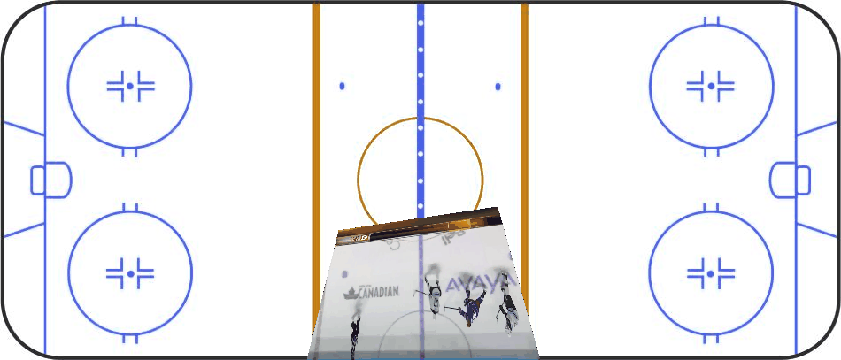
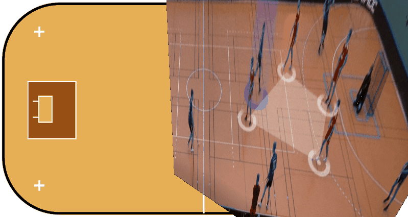

# Video Analysis in Sports – Lab 2 (CM2000, KTH)

Computer vision lab from the sports instrumentation course at KTH. The lab explores three ways to get measurable data out of ordinary sports video:

| Part | Topic | What it does |
|------|-------|--------------|
| **A** | Object tracking | Tracks a barbell through an Olympic snatch and plots its path |
| **B** | Pose estimation | Finds a runner's joints frame by frame and computes knee angles |
| **C** | Homography | Projects broadcast footage onto a top-down map of the field |

---

## A – Object tracking (barbell path)



**Notebook:** [`A_object_tracking.ipynb`](A_object_tracking.ipynb)

The barbell plate is tracked with OpenCV's **CamShift** algorithm. A region of interest is selected on the first frame, a colour histogram of it is built in HSV space, and that histogram is back-projected onto every following frame to find the plate again.

- **Task 1:** Track the plate and tune the colour mask. Narrowing the hue range to 100–140 isolates the blue plate.
- **Task 2:** Draw the centroid of the tracked box (red dot) on every frame and export the result as a GIF.
- **Task 3:** Plot the x and y position of the centroid over time.

**Findings:** Tracking works well for most of the lift, but the box shrinks at the top of the pull. A shadow shifts the colour of the plate's upper corner, so the centroid dips slightly. Adjusting the saturation and value thresholds didn't fix it, which shows that a fixed colour mask is sensitive to lighting.

---

## B – Pose estimation (running)


**Notebook:** [`B_pose_estimation.ipynb`](B_pose_estimation.ipynb)

Two pose estimation models are run on the same running video and compared:

- **MoveNet Thunder** (TensorFlow Hub), with a cropping algorithm that keeps the model focused on the runner
- **YOLOv8n-pose** (Ultralytics), with ByteTrack to follow the person between frames

Tasks:

- **Task 1:** Run skeleton tracking on the video and export it as a GIF.
- **Task 2:** Extract hip, knee and ankle coordinates with their confidence scores.
- **Task 3:** Compute left and right knee angles in the sagittal plane from upper-leg and lower-leg vectors.
- **Tasks 4–5:** Extract the same joints with YOLO and plot both models together.

**Findings:**

- Hips are predicted reliably by both models. Ankles are the weakest, with brief **left/right swaps** when one foot passes behind the other.
- Confidence scores often drop around these errors but not consistently. A higher threshold hides more wrong joints but also hides correct ones, so confidence alone can't detect swaps.
- Knee angles show a clear running cycle, from about 170° down to about 70° with the legs alternating. The sudden jumps in the curve match the swap errors.
- **MoveNet vs YOLO:** YOLO makes fewer swap errors thanks to its tracking, while MoveNet produces smoother curves when its predictions are correct. Neither model is better everywhere.
- Angles are measured in 2D, so they're only accurate when the runner moves straight across the camera view.

---

## C – Homography (field projection)

<p> 
   
   
</p>

**Notebook:** [`C_homography.ipynb`](C_homography.ipynb)

A homography maps points in the camera image onto a flat diagram of the playing field. At least four matching point pairs are clicked in the video frame and on the field image, and OpenCV computes the transformation with `findHomography` (RANSAC).

- **Task 1:** Homography of a single frame for ice hockey, American football and a sport of my choice (**floorball**).
- **Task 2:** Apply the first frame's matrix to the whole video (static homography).
- **Task 3:** Track the reference points through the video with a **KCF tracker** and recompute the matrix for every frame (dynamic homography), which handles a moving camera.

**Findings:**

- The result depends on accurately clicked points spread across the visible field. Because fields are symmetric, matching points to the wrong half flips the projection.
- Players are distorted after projection: far-away players get stretched and nearby players get compressed, since they aren't on the flat ground plane.
- A static matrix is only correct while the camera is still, which is why the dynamic version is needed for broadcast footage.
- **Application to floorball:** projected video could feed 2D player maps, heat maps and sprint statistics, a digital version of the tactics board coaches already use. The small floorball court also means less camera movement, which makes the method more reliable.

---

## Running the notebooks

The notebooks open interactive OpenCV windows (for selecting regions and clicking points), so they need to run **locally**, not in Colab or github.dev.

Main dependencies:

```bash
pip install opencv-contrib-python numpy matplotlib pillow tensorflow tensorflow-hub ultralytics
```

`opencv-contrib-python` is needed for the KCF tracker in Part C.

The notebooks also rely on helper files from the course (`tools.py`, `kalmanFilter.py`) and on the input videos, which are expected in `object_tracking/`, `skeleton_tracking/` and `homography/` subfolders.

## Credits

- Object tracking and homography code adapted from [LearnOpenCV](https://learnopencv.com) tutorials, as provided in the course material
- Pose estimation code adapted from the [TensorFlow MoveNet tutorial](https://www.tensorflow.org/hub/tutorials/movenet) (Apache License 2.0)
- YOLOv8 pose model by [Ultralytics](https://github.com/ultralytics/ultralytics)
